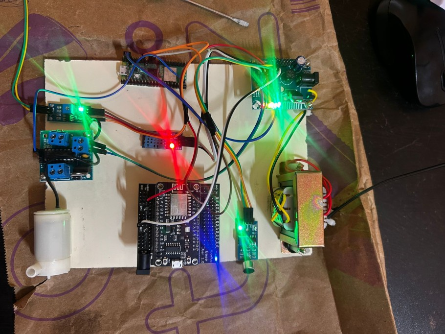
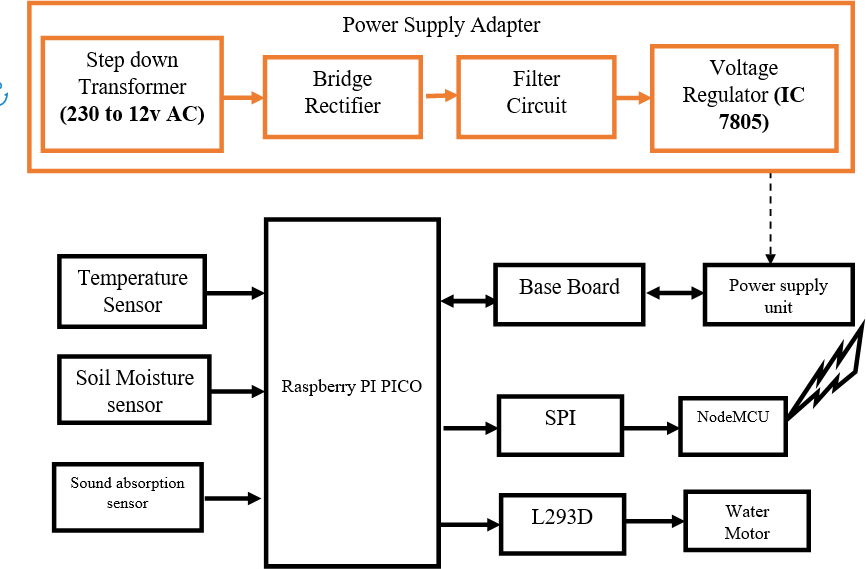
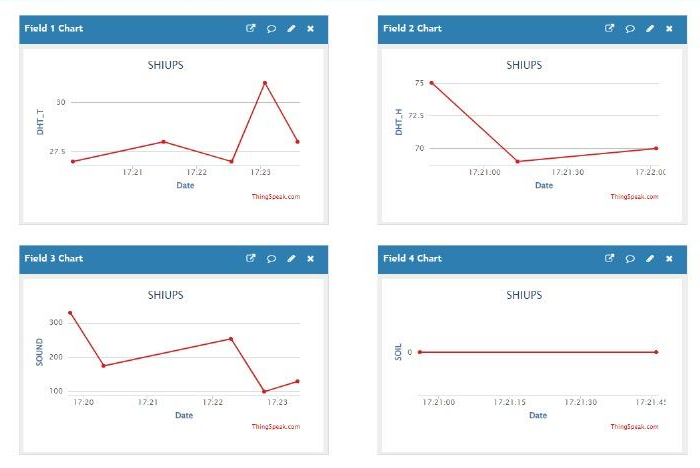

# Smart Irrigation System by Detecting Plant Squeals Using IoT

An IoT smart-irrigation prototype that combines soil-moisture, temperature/humidity and sound sensing with automatic pump control, and logs its readings to the ThingSpeak cloud. The project builds on research showing that plants under water stress emit ultrasonic "squeals", which could complement soil-moisture readings when deciding when to water.

> **Best Paper Award, IEEE ICCCT'25.** Final-year B.Tech Information Technology team project (Project Phase II, April 2025), Sri Sai Ram Institute of Technology, Chennai (Anna University). The core content is taken from the project report. Code written afterwards to fill gaps in the report is clearly labelled. See [Scope of this repository](#scope-of-this-repository).


*The working prototype (photo from the project report).*

## The problem

- Fixed-schedule or manual irrigation wastes water or leaves plants under-watered.
- Most smart irrigation systems rely on soil moisture alone and ignore the plant's own response.
- Agriculture accounts for a large share of freshwater use (about 70%, as cited in the report), so better water management matters.

The project aligns with UN Sustainable Development Goal 15 (Life on Land).

## How it works

1. **Sensing:** a soil-moisture sensor, a DHT11 temperature/humidity sensor and a sound sensor feed a Raspberry Pi Pico.
2. **Control:** the Pico reads the soil-moisture level and switches the pump output on when the soil is dry (threshold in the firmware).
3. **Cloud logging:** the Pico passes readings to a NodeMCU (ESP8266), which uploads them over Wi-Fi to **ThingSpeak** for live charts and history.
4. **Proposed:** a convolutional neural network for audio source separation, to isolate plant sounds from background noise. This is described in the report's architecture but is not implemented in this repository.



## Hardware

| Component | Role |
|---|---|
| Raspberry Pi Pico W (RP2040) | Main controller: reads sensors, controls the pump |
| NodeMCU (ESP8266) | Wi-Fi link that uploads data to ThingSpeak |
| Soil-moisture sensor | Measures soil water content |
| DHT11 | Temperature and humidity |
| Sound sensor (microphone + LM393) | Sound-level input |
| L293D motor driver + water pump | Delivers water |
| Power supply | 230 V to 12 V AC step-down transformer, bridge rectifier, filter, 7805 regulator |

See the [wiring guide](docs/wiring.md) for the pin connections.

## Firmware

### From the project report

[`firmware/pico_soil_moisture_pump`](firmware/pico_soil_moisture_pump/pico_soil_moisture_pump.ino) is the code listing from the report's Chapter 5. It runs once per second.

| Signal | Pin | Notes |
|---|---|---|
| DHT11 data | 26 | Temperature and humidity |
| Soil-moisture sensor (analog) | A1 | Reading is inverted in code (1023 minus the raw value) |
| Pump control output | 15 | HIGH when the soil reading is 45 or below, LOW above 45 |
| Serial link to NodeMCU | TX 16 / RX 17 | Software serial, 9600 baud. The report's diagram labels this link "SPI" |

To build it:

1. Install the Arduino IDE and add the Raspberry Pi Pico / RP2040 board package (Boards Manager).
2. In Library Manager, install **DHT sensor library** (Adafruit) and **Adafruit Unified Sensor**.
3. Select the *Raspberry Pi Pico W* board, open the `.ino` file and upload.
4. Open the Serial Monitor at 9600 baud to see the readings.

### Added after the original submission

The report's code listing did not include the NodeMCU uploader or any sound-sensor reading, so these were written afterwards to fill the gaps. The logic was checked on a computer with simulated inputs, but **they have not been run on the prototype hardware yet**. Check the pins and wiring against your own board before relying on them.

- [`firmware/pico_sensor_node`](firmware/pico_sensor_node/pico_sensor_node.ino): the same pump logic as the original, plus a sound-level reading (peak-to-peak amplitude over 50 ms) on pin A2. It sends one line per second to the NodeMCU: `S,<soil>,<temperature>,<humidity>,<sound>`.
- [`firmware/nodemcu_thingspeak`](firmware/nodemcu_thingspeak/nodemcu_thingspeak.ino): receives that line and uploads the latest values to ThingSpeak every 20 seconds. Fields are in the same order as the report's dashboard: 1 temperature, 2 humidity, 3 sound, 4 soil moisture.

To use the NodeMCU sketch:

1. Create a ThingSpeak channel with four fields in the order above and copy its **Write API Key**.
2. In `firmware/nodemcu_thingspeak`, copy `secrets.example.h` to `secrets.h` and fill in your Wi-Fi name, password and the Write API Key. `secrets.h` is ignored by git, so your credentials stay private.
3. Install the ESP8266 board package, select *NodeMCU 1.0 (ESP-12E Module)* and upload.
4. Upload `pico_sensor_node` to the Pico, connect the two boards as in the wiring guide, and watch the data arrive in ThingSpeak.

## Cloud dashboard

Temperature, humidity, sound and soil-moisture fields logged to ThingSpeak (from the report):



## Results (as reported)

Figures from the project report's prototype testing:

| Metric | Reported value |
|---|---|
| Sound sensor accuracy (squeals vs. background noise) | 92% |
| False positives from background noise | 8% |
| Response time | 2 seconds |
| Water delivery precision | 98% |
| Water usage reduction vs. manual methods | 35-40% |
| ThingSpeak data accuracy | 99% |
| System uptime | 99.5% |
| Temperature / humidity sensor accuracy | ±2 °C / ±5% RH |

The report does not describe the test setup or the baseline behind these numbers, so treat them as prototype-level results.

## Limitations

From the report:

- The sound sensor needs careful calibration and is sensitive to background noise (wind, rain, nearby machinery).
- Decoding plant sounds and linking them to stress levels needs more advanced algorithms.
- Real-time data and alerts depend on a stable Wi-Fi connection.

Also: the sound sensor module measures audible sound level. Detecting true plant ultrasonic emissions would need an ultrasonic microphone and much faster sampling.

## Scope of this repository

| Part | Status |
|---|---|
| Pico firmware (soil-moisture pump control, DHT11 readings) | From the report's Chapter 5 code listing |
| Architecture diagram, prototype photo, ThingSpeak dashboard | From the report |
| Extended Pico sketch (sound level, data line for the NodeMCU) | Added afterwards, not yet tested on hardware |
| NodeMCU ThingSpeak uploader | Added afterwards, not yet tested on hardware |
| Wiring guide | Added afterwards |
| CNN audio-separation model and data | Not included (described in the report, no code) |

## Repository structure

```
├── firmware/
│   ├── pico_soil_moisture_pump/   # from the report
│   ├── pico_sensor_node/          # added afterwards
│   └── nodemcu_thingspeak/        # added afterwards (copy secrets.example.h to secrets.h)
├── docs/
│   ├── wiring.md
│   └── images/
└── README.md
```

## Recognition

- **Best Paper Award** at the Fifth IEEE International Conference on Computing and Communications Technologies (ICCCT'25) for the paper on this project
- Shortlisted for the second round of Solvathon 2.0 (Sairam Innovation Eco-system)

## Future scope

- Better noise isolation with machine-learning models for detecting plant-specific sounds
- Multi-crop monitoring across larger fields with networked IoT sensors
- Solar power for remote deployments
- Edge computing on the Pico to cut latency
- Collaboration with agricultural researchers to calibrate sound detection across plant species

## Team

Priyadharshini K, Haritha M, Venkata Manasa D. Supervisor: Mr. M. Gnana Prakash.
